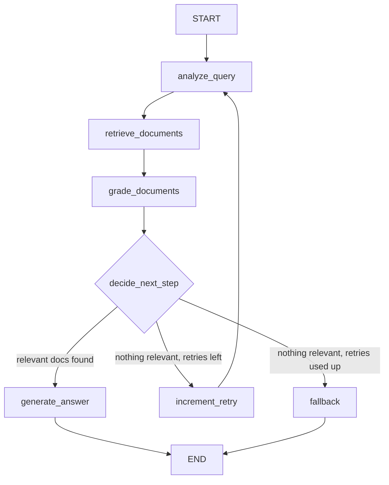

# RAG Documentation Assistant

A question-answering app over technical docs. You ask a question in plain English,
it finds the relevant parts of the documentation, and answers with citations.
If it can't find anything relevant, it says so honestly instead of making things up.

Built with Python, LangGraph, FastAPI, ChromaDB, and Google Gemini — as a take-home
assignment for an AI/ML Engineer Intern role.

---

## What it does

Say you ask: *"What is dependency injection in FastAPI?"*

The app doesn't just guess. It:

1. Cleans up your question to make it more searchable
2. Searches its documentation collection for matching pieces
3. Checks each piece — "is this actually relevant?" — and throws out the junk
4. Writes an answer using only the relevant pieces, with citations like
   `[Source: dependencies.md, Chunk: chunk_2]`
5. If nothing relevant is found, it rephrases the question and tries again
   (up to 2 retries). Still nothing? It tells you it doesn't know.

There's also a simple web UI (Streamlit) so you can ask questions, upload new
documents, and browse what's indexed — no API tools needed.

---

## How it works (the workflow)

The core is a LangGraph workflow — a small state machine where each step is a
function and the data flows between them in a shared state (the question, the
retrieved chunks, the grades, the retry count, the final answer).



What each step does, in plain words:

- **Query analysis** — An LLM rewrites your question to be clearer and more
  searchable (fixes vague wording, adds the right technical terms), and labels
  it as conceptual / how-to / troubleshooting / api-reference.
- **Retrieval** — The rewritten question is turned into a vector and matched
  against the docs in ChromaDB. Top 5 chunks come back with their metadata
  (file name, chunk id, source URL).
- **Document grading** — An LLM looks at each chunk next to your *original*
  question and votes YES or NO on relevance. Irrelevant chunks are dropped.
  The votes are saved in the state so you can see why something was kept.
- **Routing (`decide_next_step`)** — The decision point. Relevant chunks exist?
  Go write the answer. None, but retries remain? Bump the counter and loop back
  to rewrite the question differently. None and retries exhausted? Fall back.
- **Answer generation** — An LLM writes the answer using *only* the relevant
  chunks, citing each fact. If the chunks don't contain enough info, it says so.
- **Fallback** — Returns an honest "I couldn't find sufficient information in
  the available documentation." Never answers from general knowledge.

The retry loop always ends: 1 first try + 2 retries max, because the counter
only lets the loop continue while `retry_count < 2`.

---

## Why I built it this way (thought process)

The assignment's key phrase is "self-corrective." A basic RAG pipeline —
retrieve then answer — blindly trusts whatever the vector search returns. That
fails quietly: the search returns *something*, the LLM writes a confident answer
from it, and nobody notices the chunks were irrelevant.

So the grading step is the heart of this project. It separates "what the search
found" from "what the answer is allowed to use." That one filter is what makes
the system self-correcting rather than just a search wrapper.

I kept everything deliberately simple:

- **Plain functions, not classes** — each node is a function that takes the
  state and returns updates. Easy to read, easy to test, easy to explain.
- **YES/NO grading instead of fancy structured output** — a simple verdict plus
  a one-line reason, parsed with a regex. Cheaper, and when parsing fails it
  defaults to "not relevant," which is the safe side.
- **Local embeddings, cloud LLM** — embeddings happen on every ingest and every
  query, so keeping them local (and free) matters most. The LLM is only used
  for the few reasoning steps where quality matters most.
- **SQLite for feedback** — it's one table; an ORM would be overkill.

---

## Chunking and embedding choices

**Chunking: 800 characters with 150 overlap.** Small enough that each chunk is
about one idea (which makes grading accurate), large enough to keep explanations
readable. The 150-char overlap means a thought split across a boundary still
appears whole in one of the chunks.

I split on paragraph boundaries first, not fixed character counts, so chunks
break at natural pauses instead of mid-sentence. Code blocks (fenced with
\`\`\`) are kept whole whenever they fit — splitting a code example in half
would destroy its meaning.

**Embeddings: `sentence-transformers/all-MiniLM-L6-v2`, running locally.** It's
small (~90MB), fast on CPU, free forever, and good enough for technical docs.
No data leaves your machine for embeddings, and there are no per-query costs.
The tradeoff: a bigger embedding model would retrieve slightly better, but for
a small doc collection this one is plenty.

**Vector store: ChromaDB, persisted locally** in `data/chroma_db/`. It runs
embedded (no server to manage), survives restarts, and chunk IDs are stable
hashes — so re-ingesting the same document never creates duplicates.

---

## The document collection

The app ships with 5 FastAPI documentation files in `data/documents/`
(introduction, path/query parameters, request bodies, dependency injection,
error handling), each keeping its official source URL in the metadata.

But the app isn't tied to FastAPI docs — that's just the starter set. You can
add any Markdown/TXT files or URLs through the Ingest tab, or replace the
folder contents entirely and re-run the ingest script.

---

## Setup

**You need:** Python 3.11+ and a free Google Gemini API key
(get one at https://aistudio.google.com/apikey).

```bash
# 1. Create and activate a virtual environment
python -m venv .venv
source .venv/bin/activate        # Windows: .venv\Scripts\activate

# 2. Install dependencies
pip install -r requirements.txt

# 3. Add your API key
cp .env.example .env
# then open .env and paste your key after GEMINI_API_KEY=
```

The `.env` file also holds optional settings: the Gemini model name
(`gemini-2.5-flash` by default), the ChromaDB path, and the retry limit.
Everything has a sensible default except the API key.

**Note:** without the API key the app still starts, but asking a question will
tell you the key is missing. Embeddings don't need any key — they run locally.

---

## How to run

**Step 1 — index the documents** (only needed once; safe to re-run):

```bash
python scripts/ingest_documents.py
```

**Step 2 — start the app.** Two options:

*Simplest — the Streamlit UI:*
```bash
streamlit run app/streamlit_app.py
```
Opens in your browser with four tabs: **Ask** (type a question, get a cited
answer), **Ingest** (upload files or paste a URL), **Documents** (see what's
indexed), **Feedback** (rate answers).

*Or the API:*
```bash
uvicorn app.main:app --reload
```
Then open http://localhost:8000/docs for the interactive API page.

**Run the tests:**
```bash
pytest tests/ -v
```
39 tests, all passing. The LLM is mocked in tests, so they cost nothing and
need no API key.

---

## API examples

**Ask a question** — `POST /query`
```json
// request
{ "question": "What is dependency injection in FastAPI?" }

// response
{
  "question": "What is dependency injection in FastAPI?",
  "answer": "FastAPI dependency injection lets you declare... [Source: dependencies.md, Chunk: chunk_2]",
  "sources": [
    {
      "document": "dependencies.md",
      "chunk_id": "chunk_2",
      "source_url": "https://fastapi.tiangolo.com/tutorial/dependencies/"
    }
  ],
  "retry_count": 0,
  "status": "success"
}
```

When nothing relevant is found, you get an honest fallback instead:
```json
{
  "question": "How do I bake a cake?",
  "answer": "I couldn't find sufficient information in the available documentation to answer this question reliably.",
  "sources": [],
  "retry_count": 2,
  "status": "fallback"
}
```

**Add documents** — `POST /ingest` (form-data: `file` upload, or `url` + optional `document_name`)

**List indexed documents** — `GET /documents`

**Send feedback** — `POST /feedback`
```json
{ "question": "...", "rating": "positive", "comment": "Helpful!" }
```
(`rating` must be `"positive"` or `"negative"`; stored in SQLite.)

---

## Design decisions and tradeoffs

- **Grading over clever retrieval.** I put the quality control in the grading
  step rather than in exotic retrieval tricks. It's simpler and it directly
  addresses the "self-corrective" requirement.
- **Simple parsing, safe defaults.** If the grader's output can't be parsed,
  the chunk counts as irrelevant. I'd rather drop a good chunk than use a bad one.
- **No web-search fallback.** The PDF lists it as a bonus; I skipped it to keep
  the core loop solid. The fallback message is honest about the limitation.
- **Hallucination check exists but is off by default.** There's a verification
  node (`verify_answer`) that double-checks the answer against the retrieved
  chunks — enable it with `build_graph(enable_verification=True)`. Off by
  default because it costs an extra LLM call and the mandatory pipeline is
  complete without it.
- **Feedback is collected but not yet used.** It's stored for future
  improvements, not wired into retrieval yet — honest scope control for the
  time limit.

---

## Assumptions I made

1. Small collection (5 docs, ~25 chunks) — one ChromaDB collection, no sharding needed.
2. Docs are English Markdown/TXT — the chunker assumes paragraphs and fenced code blocks.
3. The evaluator has a free Gemini API key.
4. Single user running locally — no login, no rate limits.
5. The grader's YES/NO votes are taken at face value.
6. Source URLs in the metadata are correct as provided.

---

## What I'd improve with more time

- **Hybrid search** (keyword + vector) — pure vector search can miss
  keyword-heavy API reference questions.
- **Batched grading** — grading chunks one LLM call at a time is slow;
  batching would cut latency a lot.
- **Use the feedback** — close the loop: let negative feedback trigger
  re-ingestion or flag bad chunks.
- **Conversation memory** — follow-up questions ("and what about query
  params?") need chat history; right now each question stands alone.
- **Web search fallback** — as the PDF suggests, for questions outside the docs.

---

## Project structure

```
rag-documentation-assistant/
├── app/
│   ├── main.py                # FastAPI app
│   ├── streamlit_app.py       # Streamlit UI (Ask / Ingest / Documents / Feedback)
│   ├── config.py              # settings from environment variables
│   ├── api/routes.py          # the 4 API endpoints
│   ├── rag/
│   │   ├── state.py           # what data flows between nodes
│   │   ├── nodes.py           # the workflow steps (plain functions)
│   │   ├── graph.py           # the LangGraph graph + routing logic
│   │   └── retrieval.py       # vector search over ChromaDB
│   ├── ingestion/loader.py    # loading, chunking, embedding, storing docs
│   └── database/feedback.py   # SQLite feedback storage
├── data/documents/            # the 5 FastAPI docs
├── scripts/ingest_documents.py
├── tests/                     # 39 tests
├── requirements.txt
├── .env.example
└── README.md
```
